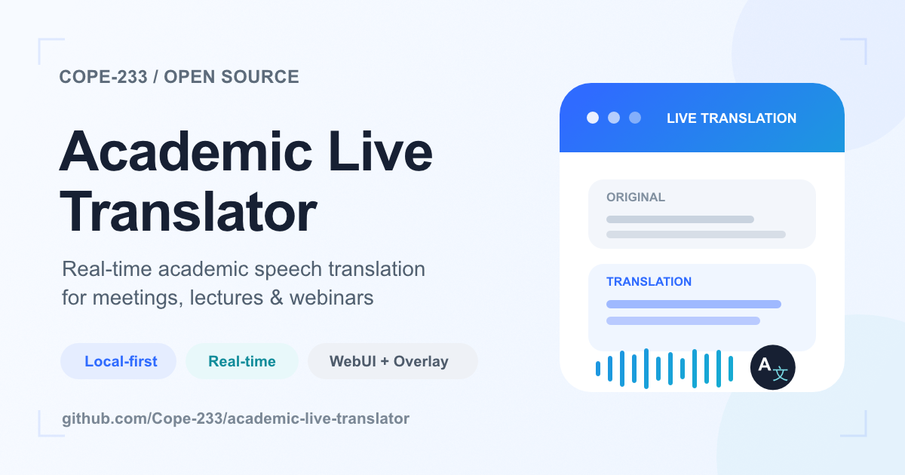

# Academic Live Translator

**简体中文** | [English](./README.en.md)

Academic Live Translator 是一个本地优先的实时语音转录、翻译与学术记录 WebUI，适用于课堂、研讨会、学术会议、日常会议、访谈以及已有音视频材料。

## 项目介绍

项目将实时音频采集、ASR、翻译与学术记录整合到一个浏览器工作区中，并尽量将模型、配置、缓存和会话数据保存在项目目录内，方便迁移与管理。

主要功能：

- 实时原文 / 译文双栏显示，支持同步滚动与自动跟随最新内容
- 支持整句输出与实验性实时增量输出；实时模式会在讲话过程中更新临时识别与翻译，最终结果再写入 Session
- 本地 Whisper ASR：`tiny`、`base`、`small`、`medium`、`large-v3-turbo`
- Apple silicon 支持 MLX / Metal；Windows NVIDIA 支持 CUDA；其他环境可使用 CPU
- 支持 Bing Free、Microsoft Translator 与 OpenAI-compatible 翻译服务
- 支持 OpenAI-compatible ASR，可连接 llama.cpp、vLLM、LM Studio、LocalAI 等服务
- 浏览器麦克风、标签页 / 屏幕音频、系统音频 + 麦克风混合
- Windows WASAPI 系统音频回环与原生麦克风捕捉
- 音频 / 视频文件转录与翻译
- 实验性双语悬浮字幕窗，可覆盖 Zoom、WebEx、网页课程或演示文稿
- 可自定义语音分段、实时更新频率、翻译上下文、术语保护与采集保存参数，设置会自动保存在本地配置中
- 学术术语表、重点标记、笔记、截图与 Session Library
- TXT、Markdown、SRT、JSON 导出
- Portable-by-default：`.venv/`、`data/`、`models/`、`runtime/`、`cache/`、`logs/` 均保存在项目目录内

### Whisper 模型选择建议

项目默认使用 `base`。如果不确定应该选择哪个模型，建议保持默认设置。对于实时字幕，模型越大并不一定越适合；硬件性能不足时，大模型可能无法跟上讲话速度，并进一步拖慢后续翻译。

| 模型 | 参数量 | 官方参考显存 | 建议配置 | 适合场景 |
| --- | ---: | ---: | --- | --- |
| `tiny` | 39M | ~1 GB | 4 核 CPU、8 GB 内存即可；无需独立显卡 | 低配置电脑，优先保证实时速度，准确率要求较低 |
| `base` | 74M | ~1 GB | 4 核以上现代 CPU、8 GB 内存；有 GPU 会更快 | **默认推荐**，速度、准确率和资源占用最均衡 |
| `small` | 244M | ~2 GB | 建议 6 核 CPU、16 GB 内存，或 4 GB 以上显存的 NVIDIA GPU | 中等配置电脑，希望提高识别准确率 |
| `medium` | 769M | ~5 GB | 建议 NVIDIA GPU 6 GB 以上显存，或 16 GB 以上统一内存的 Apple silicon；不建议仅靠普通 CPU 实时运行 | 较高配置设备，对准确率要求较高 |
| `large-v3-turbo` | 809M | ~6 GB | 建议 NVIDIA GPU 8 GB 以上显存，或 16 GB 以上统一内存的 Apple silicon；CPU-only 不推荐用于实时字幕 | 高性能设备，在保持较高准确率的同时使用更大的模型 |

> 显存数字来自 OpenAI Whisper 的官方参考值。Academic Live Translator 在 Windows / Linux 上使用 faster-whisper，在 Apple silicon 上可使用 MLX，因此实际内存占用和速度会因设备、计算精度和音频内容而变化。CPU-only 用户优先选择 `tiny`、`base` 或 `small`。

## 使用方法

### Windows

需要已安装 Python。下载或克隆项目后，直接双击：

```text
start_webui.bat
```

首次启动会自动完成项目环境初始化，包括创建 `.venv/`、安装依赖、准备本地 Whisper 模型，并在检测到 NVIDIA GPU 时准备项目目录内的 CUDA Runtime。安装完成后会自动打开：

```text
http://127.0.0.1:8765
```

之后每次使用只需要再次运行：

```text
start_webui.bat
```

也可以使用 PowerShell：

```powershell
Set-ExecutionPolicy -Scope Process Bypass
.\start_webui.ps1
```

Windows 用户可在 **音频来源** 中选择 WASAPI 系统音频，用于直接捕捉 Zoom、WebEx、浏览器课程或其他桌面程序正在播放的声音。

### macOS（Apple silicon）

适用于 M 系列 Mac。建议使用原生 arm64 Python。

进入项目目录后运行：

```bash
chmod +x start_webui.sh
./start_webui.sh
```

首次启动会创建 `.venv/`、安装依赖并准备 Whisper 模型。默认自动模式会优先使用 MLX / Metal 加速；也可以在 **设置 → ASR Provider → 设备** 中切换为 CPU。

WebUI 地址：

```text
http://127.0.0.1:8765
```

如果提示 Python 架构不是 `arm64`，请安装原生 Apple silicon Python，删除项目中的 `.venv/` 后重新运行启动脚本。

### Linux / Intel Mac

进入项目目录后运行：

```bash
chmod +x start_webui.sh
./start_webui.sh
```

Linux 与 Intel Mac 默认使用 CPU Whisper，可使用浏览器麦克风、标签页 / 屏幕音频以及媒体文件工作流。

WebUI 地址：

```text
http://127.0.0.1:8765
```

### 启动后

1. 在 **实时** 页面选择音频来源。
2. 设置源语言与目标语言，并选择 **整句模式** 或实验性的 **实时模式**；默认使用整句模式。
3. 点击 **开始监听**。
4. 原文与翻译会显示在当前 Session；实时模式中的临时结果只用于即时显示，语音段结束后才保存最终结果。
5. 需要更换 ASR 或翻译服务时，在 **设置** 中选择本地 Whisper、Microsoft Translator 或 OpenAI-compatible Provider。
6. 更细的语音检测、分段、实时更新、翻译与保存参数可在 **设置 → 自定义设置** 中调整，保存后下次启动会自动恢复。
7. 单屏使用 Zoom、WebEx 或网页课程时，可启用标记为 **Experimental** 的悬浮窗，将原文与译文保持在其他窗口上方。

本地会话、模型、缓存、录音和截图默认保存在当前项目目录中；迁移或删除程序时可直接管理整个项目文件夹。
